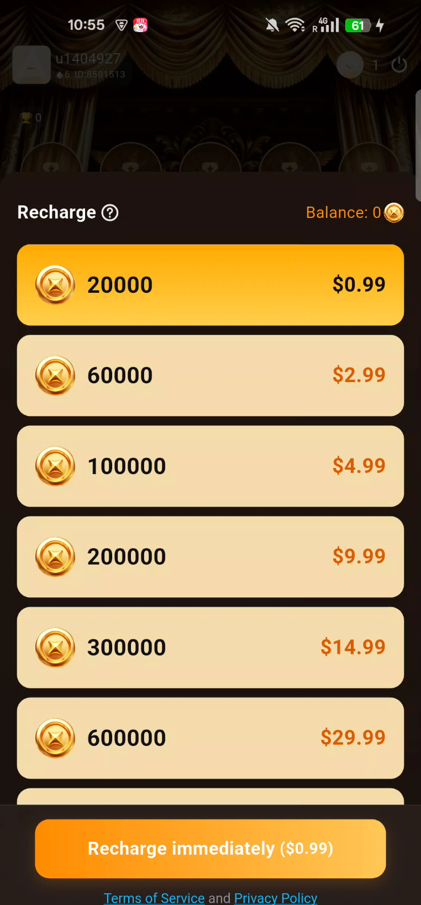
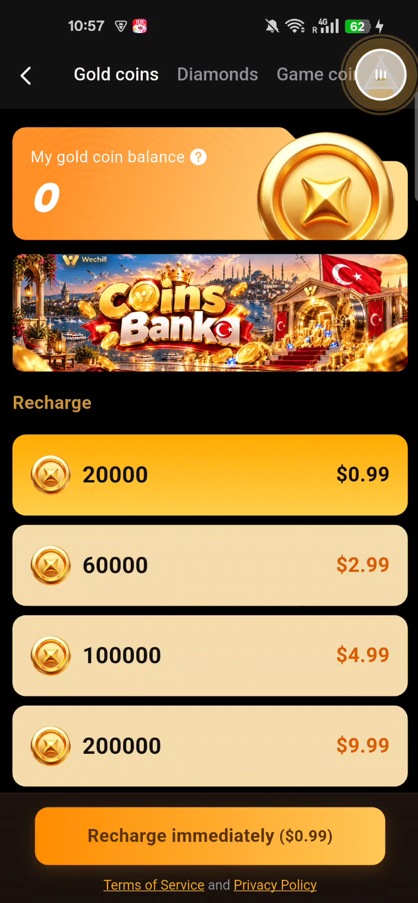
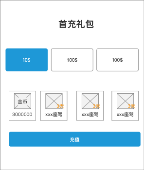
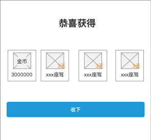
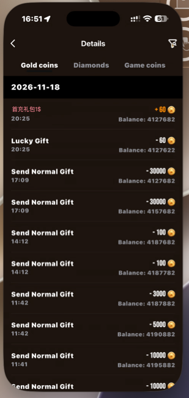
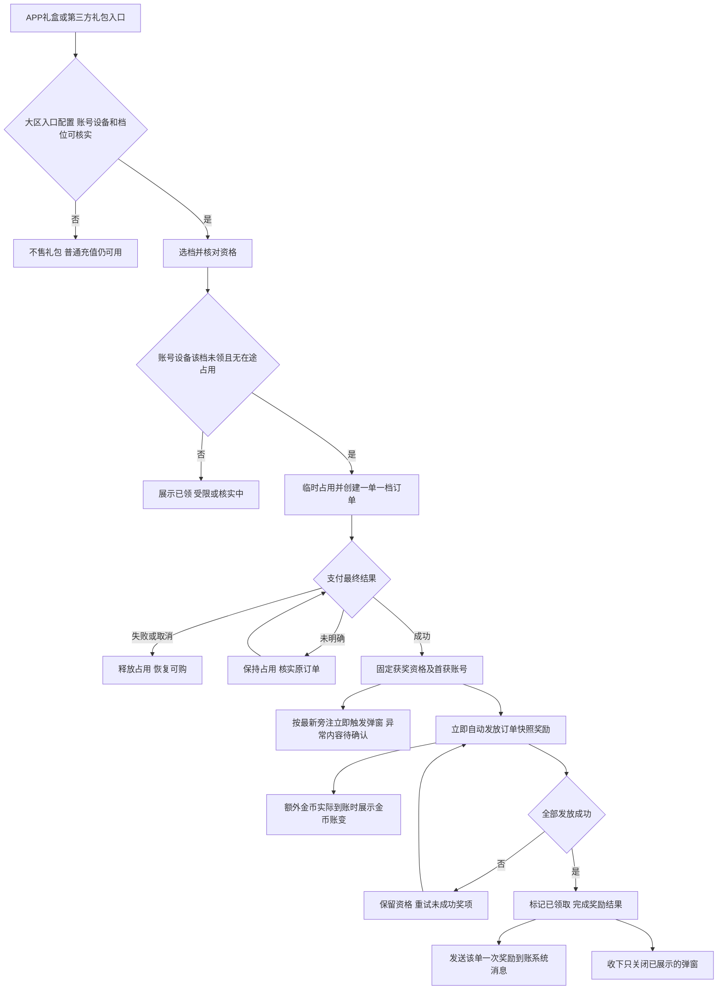
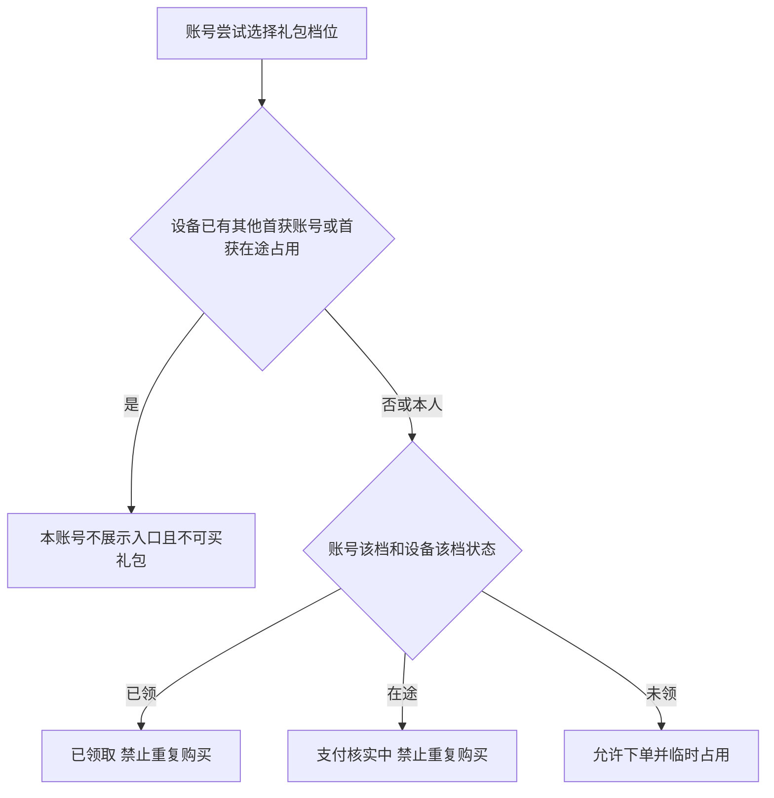

# 首充礼包需求文档

> 对应同目录 `wechill首充礼包.rp` 的 H5「首充礼包」页面、两处充值礼盒入口、付款示意、获奖弹窗和画布旁注。**【原型】**是原型直接表达的内容；**【本稿口径】**是用户要求按产品建议采用的解决方案，不表示原型已画出或现网已实现。示意金额和奖励数量均不作为上线配置。

## 一、目标与范围

用户从充值页礼盒进入礼包页，选择档位并完成对应充值，获得该档**额外礼包奖励**。APP 与第三方充值采用同一资格、档位与发奖口径。历史已经充值的老用户也能参加；本活动内已取得礼包的档位不能重复获得。

**“首充”定义【本稿口径】：** 指在本活动某档位首次符合领取条件的充值，**不是账号历史第一笔充值**。页面标题沿用「首充礼包」；礼包页增加说明：「历史充值用户也可参与；每个档位的礼包奖励仅可获得一次，且受注册设备限制。」并说明：「同一注册设备仅首个获得礼包的账号可继续参与。」

| 范围 | 处理方式 |
|---|---|
| 基础充值 | 支付与基础金币到账沿用既有充值链路，和礼包额外奖励分开记录、展示及退款 |
| 礼包 | 仅针对明确选择礼包档位形成的礼包订单；普通商品直接充值不自动送礼包 |
| 入口 | APP 充值弹层、金币充值页的礼盒；第三方渠道的礼包档位购买入口 |
| 范围外 | 不新增分享、榜单、礼包历史页、每日重置、后台新页面或其他钱包页签入口 |

## 二、业务对象与资格

| 对象 | 定义与归属【本稿口径】 |
|---|---|
| 活动 | 一次独立首充礼包活动。停启不重置已领资格；下一次活动另建活动身份。 |
| 大区与入口配置 | 【最新旁注】不同大区的每个档位分别配置套餐内容；APP 打开与充值链接打开的礼包分别配置，但共用充值资格。大区归属依据、两套配置的具体字段与档位身份映射，原型未说明，待确认；不得据此分别累计资格。 |
| 档位 | 活动内有独立身份、展示顺序、对应可售商品与奖励清单；展示金额不作为档位唯一标识。 |
| 账号 | 付款与奖励接收者；同账号在同活动同档最多领取一次，换设备、换渠道不重置。 |
| 注册设备 | 以账号注册时登记的设备为归属；同一设备注册的账号归于同设备。后来登录新设备不改变本活动归属。无法核实原注册设备时不售卖礼包，仍允许普通充值。设备标识变化不自动生成新资格。 |
| 礼包订单 | 每单固定一个账号、注册设备、档位、实际充值商品、渠道及当时奖励清单；未选礼包的普通订单不事后转换为礼包订单。 |
| 奖励结果 | 记录每项额外奖励发放、撤销、订单归属及资格消耗结果；基础充值资产另行记录。 |

**统一判定：** 活动、大区对应档位及当前入口配置有效 → 账号和注册设备可核实 → 账号该档未领、设备该档未领 → 无冲突在途订单 → 核对设备首获账号 → 固定档位与奖励 → 付款成功 → 自动发奖。APP 隐藏入口只是前端展示，APP 与第三方下单及成功付款处理均执行同一资格校验；不能以支付回跳页面直接判定成功。

### 2.1 资格限制

1. **【原型】** 每个注册设备在每个首充档位仅可获得一次该档奖励，已领取档位按钮置灰，显示「已领取过该档位奖励」。**【本稿口径】**增加同账号同档仅一次，避免换设备或换渠道重复领取。
2. **【用户确认的统一口径】** 不论整套礼包或当前档位是否包含金币、钻石，同注册设备仅首个成功支付并取得礼包资格的账号可继续领取其余未领档位；同设备其他账号不显示 APP 入口，通过第三方充值也不能获得礼包。
3. **【原型】** 历史已充值用户在新充值时可得礼包。历史普通充值不算本礼包已领，但老用户仍受账号、设备及档位限制。
4. 设备**首获账号**以该设备第一笔礼包订单支付成功为准；付款前只是临时占用，不算获奖。首获后该活动内归属固定，即使退款也不把独占资格转给另一个账号。【本稿口径】

### 2.2 下单占用与并发

| 时刻 | 规则【本稿口径】 |
|---|---|
| 打开页面、切换档位 | 只展示资格，不占名额；先打开页面不等于首获账号。 |
| 创建礼包订单 | 暂时占用账号该档和设备该档；设备尚无首获账号时，同时暂时占用设备首获资格。同范围的另一笔礼包订单不得并发进入支付，显示「该礼包正在支付中，请稍后查看结果」。 |
| 付款失败/取消 | 只有支付渠道确认最终失败/取消才释放占用；关闭页面不代表取消。释放后可再次购买。 |
| 付款结果未知 | 保持占用并核实订单；前端超时不擅自释放。结果迟到时仍按原订单处理，不让另一账号抢跑。 |
| 付款成功 | 将占用转为该订单的获奖资格，并确定设备首获账号；即便奖励未发完，也不释放该资格，只继续处理原单。 |

**异常已付订单：** 若渠道延迟或绕过礼包下单导致已付款却无资格，不发额外礼包，发起原路退款；已到账的基础充值资产按退款规则核销。退款未完前向用户展示「该笔礼包不符合领取条件，退款处理中」，失败则保留订单转人工处理。不能收了礼包的钱却只给基础充值，也不能让用户再付一笔来补领。普通充值订单不受此条影响。

## 三、页面与交互

### 3.1 充值弹层礼盒入口



**原型：** Recharge 弹层有礼盒，但没有画至礼包页的连接箭头。**本稿口径：** 正式启用，点击进入与金币充值页礼盒相同的 H5 页面。弹层原金币套餐、余额和 `Recharge immediately` 仍是普通充值；直接买普通商品不自动送礼包。

礼盒仅在活动有效、账号设备可核实且至少一档可购买时展示。**【最新旁注】所有首充档位均充值完毕后隐藏两处 APP 礼盒入口**，不再保留“全档已领可由礼盒回看”的旧建议；设备已由其他账号首获、注册设备不可核实、活动结束或没有可买档位时也隐藏。入口状态读取统一资格，不能只按本地缓存展示。已支付订单的结果承接不能依赖被隐藏的入口，具体可回看路径待确认。

### 3.2 金币充值页礼盒入口



**原型：** Gold coins 充值商品旁有礼盒，画布箭头指向礼包页；旁注要求礼盒做动图。金币、钻石、游戏币页签只是原充值背景，不把本礼包扩展到其他页签。

**本稿口径：** 礼盒点击目标和展示资格与 3.1 完全相同。可见时播放一次提示动画并停在静态图；重新进入充值页可重播。整块图标始终可点击；动图加载失败、后台切换或系统停用动画时展示可点击静态图。资格变成不可见时隐藏图标与点击区域。普通金币套餐按实际商品展示，不把截图示意价当礼包配置。

### 3.3 首充礼包 H5



| 可见字段/控件 | 数据来源及行为 |
|---|---|
| 标题「首充礼包」 | 沿用原型，业务含义见第一章。 |
| 档位选项 | 按当前大区、当前入口（APP／充值链接）展示相应配置的有效档位、真实商品价、顺序及已领状态；两套配置共用充值资格，不能因切换入口重复获奖。原型 `10$ / 100$ / 100$` 是示意；同价两档须有不同档位身份及对应奖励，不能凭价格推断。不同入口档位如何映射同一资格，待确认。 |
| 当前档奖励 | 随切换显示该档奖金币、钻石、座驾等的名称、数量、期限；原型 `3000000`、`xxx座驾`、`3天` 只是占位。 |
| 「充值」 | 当前档可购买时可用，点击先确认所选档位及真实支付金额，再进入该档对应商品的支付。 |
| 已领按钮 | 保留原型「已领取过该档位奖励」置灰；已领档仍能切换查看，但不能购买。 |
| 规则说明 | 奖励区下方展示第一章的首充定义和适用的设备限制；原型尚无此区，需同步补图。 |

**默认与空态：**【最新旁注】默认选中未充值的最低金额档位；同价并列时沿用配置展示顺序选最靠前的一档【本稿口径】。所有档位已充值完毕时 APP 礼盒入口隐藏，不再约定可由礼盒进入回看；用户从保留的合法链接进入无可买档的页面如何展示、已付订单从何处回看，待确认。活动结束或无可展示档时显示「礼包已结束」且无充值按钮；读取失败时显示「加载失败，请重试」，禁用礼包支付，重试后重新判定资格。

**交互：** 切换档位不占名额；点「充值」时再次校验，成功创建一单一档的礼包订单才进入支付。支付结果不明时按钮显示「支付结果确认中」且不可重复下单；关闭页面、切后台或返回，重进时继续读原订单。最终失败/取消恢复可充；付款成功而奖励未完成则显示「奖励发放中」；全部发完显示已领。另一账号抢先成为首获账号后，当前旧页面应立即失去下单资格，显示「当前账号无法参与」；下次从充值页不显示入口。【本稿口径】

### 3.4 获奖弹窗



**最新原型：**「恭喜获得」、四格奖励和「收下」；画布新增旁注「支付成功后立即发放奖励并弹窗」。按旁注，支付成功即触发自动发奖与弹窗；「收下」只关闭弹窗，不触发发奖。**冲突边界待确认：**若奖励未立即全部到账或发奖失败，原型没有给出“恭喜获得”弹窗如何与真实到账状态一致的处理方式；旧稿的“全部发完才弹”与“立即弹窗”不能同时作为无条件规则执行。正常即时全部到账可显示获奖内容，异常仍须告知发奖中或失败，不能把未到账说成已领取。

弹窗按本订单创建时的档位奖励清单显示，不读取后来切换的其他档或新配置。关闭弹窗后刷新原充值页资产和档位状态。用户未看到弹窗就离开时，尚未展示过的获奖结果只补展示一次；**所有档位充值完毕后入口已隐藏**，不能再以“下次从礼盒进入”作为唯一承接路径，补展示触达方式待确认。付款成功但奖励仍在处理中或失败，不显示「恭喜获得」，只显示「充值成功，礼包奖励发放中，请勿重复支付」。基础充值到账与额外礼包结果分开反馈。【本稿口径】

### 3.5 金币账变记录（首充礼包奖励）



**原型与用户确认：** 画布新增「帐变记录」示意；在 `Details` 的 `Gold coins` 页签，叠加款项名「首充礼包1$」，对应行有金币增加、发生时间及 `Balance` 余额。原图底部旧记录本身截断，不能凭此补画后续内容。用户要求：通过首充获得的金币在金币帐变展示，款项名为「首充礼包x（套餐价格）$」。

| 展示项 | 规则 |
|---|---|
| 触发与范围 | **礼包额外金币实际到账时**，在收款账号的金币账变展示对应入账；APP 与充值链接购买一致。无额外金币的礼包不生成这类金币账变；支付成功但金币未到账时不预记。基础充值金币沿既有充值账变链路展示，不能与额外奖金币合并为一笔，也不能重复入账。 |
| 款项名 | 展示格式为「首充礼包x$」；`x` 是该笔礼包订单锁定的**套餐价格数字**。用户描述中的「（套餐价格）」解释 x 的取值，不作为页面展示文字。原型「首充礼包1$」仅为示意；例如订单锁定套餐标价 `10$`，则显示「首充礼包10$」。不取奖励金币数、档位序号或第三方换汇后的实际扣款金额；后续改价不改既有记录。若套餐没有美元标价，固定 `$` 后缀如何展示待确认，不把其他币种冒充美元。 |
| 金额、时间、余额 | 金额按**实际入账的额外金币数**显示正数；时间为这笔金币实际到账时间；余额为入账后的金币余额。日期分组及列表排序沿用现有金币账变页面。原型的 `+60`、余额及 `1$` 都是示意值，不是正式配置。 |
| 追溯与去重 | 该条金币账变可追溯至礼包订单及对应金币发放结果；重复支付通知、补发重试或刷新不产生第二条相同入账。若金币先到账、其他奖项仍在发放，金币账变已可见；6.1.1 的整单奖励到账系统消息仍待**全部额外奖励**完成才发送。 |
| 退款撤回 | 已到账金币按 6.3 核销，保留原正向账变用于追溯；实际撤回时按既有金币退款账变方式记录对应扣减，不将原正向记录改成从未发生。扣减记录的具体款项名原型未给出，沿用既有口径，不在此另造文案。 |

**EG（原型示意，非正式套餐或奖励配置）：** 套餐价格 `1$` 的礼包额外金币实际到账 `60`，金币账变出现「首充礼包1$」与 `+60`，时间是金币到账时间，余额是入账后余额。即便此单座驾仍待发，金币账变已出现，但不能提前发送“全部礼包奖励已到账”的系统消息。

## 四、APP 与第三方充值

| 购买路径 | 资格、订单与奖励口径【本稿口径】 |
|---|---|
| APP 礼盒 → 礼包页 → 充值 | 明确选择一档后建礼包订单；支付成功按该档自动发奖。 |
| APP 直接点普通充值商品 | 只有普通充值；即便金额与某礼包档相同，也不自动获得礼包。 |
| 第三方礼包购买入口 | 按充值链接单独配置和当前大区套餐展示所选档位与额外奖励；先验证收款账号并核实其登记注册设备，与 APP 共用领取资格，再创建一单一档订单；成功后自动发奖。链接配置与 APP 档位的资格映射待确认，不能分配第二份独立资格。 |
| 第三方普通充值 | 没有明确绑定礼包档位的订单只按普通充值处理；通用“充值成功”通知不自动命中礼包。 |
| 无法核实账号或注册设备 | 不售卖礼包档，提示「当前无法确认礼包领取资格，请在 APP 内查看」；允许普通充值。不能先收费再补猜设备。 |

最新画布的「三方渠道支付」为普通商品收银台示意，显示商品、订单、币种和实付金额，不能从截图推断该商品就是礼包档位，也不能把其示例价格当运营配置。第三方付款前须说明「本次是否包含首充礼包」及命中档位。同设备其他账号不能绕过 APP 入口限制从第三方获得礼包。APP、第三方重复通知按同一订单处理一次。第三方币种、手续费和支付方式按真实渠道商品展示，不以原型示意美元价代替实付价。

## 五、业务流程与状态

### 5.1 充值与发奖



异常已付无资格订单不进入发奖，而走第二章的原路退款、基础资产核销及人工异常处理；退款结果未核清时不放开原订单在途限制。图中未画普通充值主链，普通充值不会自动转为礼包订单。

### 5.2 同设备跨账号



**设备风控 EG（示意，不代表正式套餐）：** A、B 都以注册设备 X 归属本活动，礼包只有座驾也好、含金币或钻石也好，资格结果相同。A 成功支付第一档后，A 可参加未领的第二档；B 的 APP 礼盒隐藏，经充值链接也不能取得礼包。A 换设备登录或切入口均不能重复取得第一档。

**并发反例：** A 先打开页面但未付，B 先建单，A 暂时不能并发购买。B 最终付款失败释放占用后 A 可下单；B 付款成功后成为首获账号。A 本活动不能再获得任何档；B 可继续购买该设备尚未领取的其他档。A 换手机登录也不能重领已领档或绕过设备首获限制。

### 5.3 结果状态表

| 状态 | 进入条件 | 页面与资格 | 退出方式 |
|---|---|---|---|
| 可购买 | 活动、账号、设备、该档均符合条件 | 展示「充值」 | 建单后进入支付中 |
| 支付中/核实中 | 已建单，支付最终结果未知 | 保持临时占用，不展示已获奖；退出页面不释放 | 支付失败/取消或成功 |
| 支付失败/取消 | 渠道确认最终未付款 | 释放占用，保留未领资格 | 用户可重新下单 |
| 已付款待发奖 | 支付成功，奖励尚未全部完成 | 保持资格及首获账号；提示发放中，重试原单未成功奖项 | 全部到账后已领取，撤销走退款 |
| 已领取 | 该单全部额外奖励成功 | 原型已领档按钮置灰；同账号、设备该档不再获奖；所有档位均已充值完毕时 APP 入口隐藏 | 退款时保留已使用资格，不恢复可买 |
| 账号受限 | 设备已由其他账号首获或暂时占用 | 入口隐藏，第三方不可买礼包 | 临时占用确认失败可释放；已首获则本活动不解除 |
| 活动结束/无档 | 不再新建礼包订单 | 隐藏入口；已创建订单照原快照完成 | 新活动另建身份 |
| 退款中/已退款 | 付款撤销或异常订单退款 | 不发新奖，核销基础与额外资产；资格不重置 | 保留最终处理记录 |

## 六、奖励、配置与退款

### 6.1 奖励发放

| 项目 | 规则【本稿口径】 |
|---|---|
| 基础资产与额外奖励 | 基础充值金币沿既有链路到账；礼包额外金币、钻石、座驾各自入账记明细，互不冒充。额外金币实际到账时同步展示金币账变，款项名及去重规则见 3.5；不必等其他礼包奖项完成。 |
| 自动发奖 | 确认支付成功后自动发放；每个奖项独立记录成功结果，全部完成后才记「已领取」；此时按 6.1.1 发送奖励到账系统消息。获奖弹窗的立即展示与延迟发奖边界仍按 3.4 的待确认说明处理。 |
| 失败重试 | 仅重试该订单未成功的奖项；已成功的不再发。持续失败保留原订单由人工补发，人工处理也必须核对原奖项结果；用户无需再付款。 |
| 唯一限制 | 同活动同账号同档最多一份，同活动同设备同档最多一份，同订单同奖项最多到账一次；重复通知和刷新不能二次发奖。 |
| 限时物品 | 从实际发放成功时起算配置天数。已持有同款时，取现有到期时间与本次发放时间中较晚者再追加本次天数，不覆盖已有剩余时间；到期依原物品规则失效。 |

### 6.1.1 奖励到账系统消息【本稿拟定】

- **触发与接收：** 该笔礼包订单的**全部额外奖励实际发放成功**后，向购买该礼包的账号发送一条站内系统消息。APP 购买和充值链接购买采用同一规则；系统消息只通知奖励到账，不承担领取动作。基础充值资产到账不单独触发这条礼包消息。
- **唯一性与异常：** 同一礼包订单只发送一条到账消息；支付通知重复、页面刷新或已成功奖项重试，不重复发送。部分奖励尚在发放、发放失败、支付失败或无资格退款时不发送“已到账”消息；原订单补发至全部成功后再发送。消息发送失败时保留待发送结果并重试，不重复发奖，也不因为消息失败改变礼包已领资格。退款后的权益仍按 6.3 处理，历史到账消息不作为当前权益有效的证明。
- **标题模板：**「首充礼包奖励已到账」。标题表示奖励场景，不拿金币、钻石或座驾名称拼标题。
- **正文模板：**

  ```text
  您的首充礼包奖励已到账。
  奖励：
  {奖励名称}*{数量或有效天数}
  {奖励名称}*{数量或有效天数}
  ```

  明细逐项换行，顺序取该笔订单创建时固定的奖励清单；仅列**实际发放成功的额外礼包奖励**，不混入基础充值到账资产。永久数量类展示实际数量，限时物品展示实际发放的有效天数；没有的奖励项不出现，不输出空行。文案使用用户所在端的现有语言展示机制，具体译文随多语言表提供，不在此伪造翻译。
- **排版 EG（示意，非正式奖励配置）：** 若某笔订单的额外奖励为“金币 100”和“流星座驾 3 天”，则消息标题为「首充礼包奖励已到账」，正文为：

  ```text
  您的首充礼包奖励已到账。
  奖励：
  金币*100
  流星座驾*3天
  ```

  若礼包只配置座驾而不含金币、钻石，消息只列座驾；**设备首获账号的资格判断不因此变化**。若金币已发、座驾仍待发，则此时不发送“已到账”消息，待座驾实际发放成功后发送一次。

### 6.2 档位与配置生效

【最新旁注】每个档位按不同大区配置不同套餐内容；通过 APP 打开与通过充值链接打开分别配置，**充值资格共享**。两套配置的具体字段、同一档位身份映射及用户大区认定规则尚未画明，须确认后才能形成可售映射，不按入口或大区另发一份资格。每档配置独立身份、顺序、实际可售商品、展示价、奖励项及数量/天数、启停状态。**奖励可以包含或不包含金币、钻石；不论奖励类型，均执行设备首获账号独占这一套资格规则。**充值前展示价与支付商品价须一致；渠道换汇或手续费按最终支付页金额说明。原型 `10$ / 100$ / 100$`、`3000000`、`xxx座驾`、`3天` 均是示意，**本文不编造正式商品价格或物品编号**。同价可有不同档位，但用户须明确选档；一笔礼包订单只命中一档，不能付一次领两个同价档。未配真实商品或奖励不完整的档位不可售卖。

**配置版本【本稿口径】：** 新配置只影响新建订单；已建单固定商品、档位、奖励和设备首获账号独占资格。调整奖励、顺序或下架档位不追溯既有订单；已下架档不再新建订单，已支付订单仍按原清单发奖。**活动期间改变奖励种类不改变设备首获账号归属及已领取资格；已建订单仍按创建时的奖励清单处理。** 旧活动停启不清已领资格。老用户的历史普通充值不抵扣新活动资格。

### 6.3 退款与撤销

| 场景 | 处理口径【本稿口径】 |
|---|---|
| 尚未成功付款 | 不入基础充值、不发礼包，确认失败/取消后释放临时占用。 |
| 已付、礼包尚未全发时退款 | 停止未发奖项，撤回已发奖项，基础资产按原充值退款链路核销；档位资格不恢复。 |
| 已付且礼包已发后退款 | 撤回可撤回的额外金币、钻石与限时物品权益，基础资产按退款链路核销。已消费或已过期资产不强造负余额/负时长，记录未追回差额交人工核对；档位保持已用，防止付—领—退循环领多份。 |
| 无资格异常已付订单 | 不发礼包，原路退款并核销已到账基础资产；退款失败保持异常，人工处理，不让用户另付补领。 |
| 重复退款通知 | 同订单同资产仅撤回一次；未完成项可重试，原付款、资产和退款结果可追溯。 |

## 七、异常反馈

| 情形 | 处理【本稿口径】 |
|---|---|
| 配置或资格加载失败 | 「加载失败，请重试」，不开放礼包支付；普通充值仍可用。重试重新核对。 |
| 同设备另一账号在途 | 「该礼包正在支付中，请稍后查看结果」；已有首获账号后其他账号入口隐藏、三方禁止买礼包。 |
| 用户关闭支付页面，结果未知 | 保持核实中，不判失败或已领取；重进展示原订单结果。 |
| 付款成功但发奖中 | 「充值成功，礼包奖励发放中，请勿重复支付」，刷新读原订单，自动补发未成功项。 |
| 获奖弹窗未出现 | 权益已到账不受影响；下次通过礼盒进入礼包页补展示一次。 |
| 付款成功但资格异常 | 不发礼包，原路退款及基础资产核销；告知退款中，失败转人工处理。 |
| 注册设备缺失或变更 | 不可购买礼包；提示到 APP 核实注册设备，不凭新设备重置资格；普通充值可用。 |
| 活动下架或配置变更 | 不建新订单；旧订单按创建时内容发奖或退款，已领记录保留。 |

## 八、原型与本稿口径差异

| 原型或旁注 | 本稿确定的处理 | 原型需同步 |
|---|---|---|
| 最新获奖弹窗已写「收下」且旁注要求支付成功立即发奖并弹窗 | 正常发奖完成后「收下」只关闭；发奖失败或延迟时的弹窗时点仍待确认 | 补失败／延迟状态的触发说明，不再要求把「领取」改成「收下」 |
| 设备风控旧旁注已从当前画布移除 | 用户已确认不论是否包含金币、钻石，均执行同设备首获账号独占规则；当前原型未再写明完整设备规则 | 如需原型自解释，应补统一设备资格说明；移除旧旁注不表示取消用户确认的规则 |
| 左侧充值弹层礼盒未画跳转 | 正式启用，与金币充值页共用 H5 | 充值弹层至礼包页连接 |
| 重复 `100$` 和奖励占位符 | 正式商品—档位—奖励映射替换占位值；新增大区／入口配置与共享资格映射需确认 | 档位及获奖内容 |
| 新旁注写默认选中未充值的最低金额档位 | 已按最低金额档位选中；同价以配置顺序处理【本稿口径】 | 对应档位默认态 |
| 两处新旁注写所有档位充值完毕后隐藏入口 | 已取消全档已领时可由 APP 礼盒回看的旧建议 | 两处入口与结果承接需同步 |
| 最新旁注分别配置 APP／充值链接及不同大区套餐 | 新增配置口径，资格仍共享；具体档位映射及大区归属待确认 | 配置标注与三方展示 |
| 新增「帐变记录」及「首充礼包1$」示意 | 按 3.5 展示额外金币到账的金币账变；套餐价及 `+60` 均是示意 | 非美元套餐的 `$` 文案口径仍待确认 |
| 无支付中、发奖中、退款等状态画面 | 依第五、七章补最小状态反馈，不把发奖中显示为已领取 | 礼包页和支付结果承接 |

**交付边界：** 本文已将最新原型的默认选档、全档完成隐藏入口、大区及入口分别配置、立即发奖、金币账变示意写入对应章节；设备旧旁注已从当前画布移除，用户确认的不按奖励类型分流口径仍是现行规则。结果补展示路径、配置映射、奖励延迟弹窗及非美元套餐账变款项名仍待确认。真实商品价、奖品、数量与第三方支付支持能力仍需据实际可售配置及渠道能力落地，本文不凭原型示意捏造数值或声称已上线。
